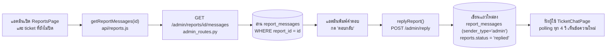
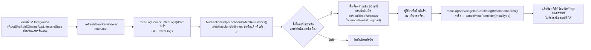

# ARCHITECTURE — โครงสร้างระบบ

เอกสารนี้สำรวจจากโค้ดจริงทั้งหมด (ไม่ได้เขียนจาก "ควรจะเป็น") ครอบคลุม
`backend/` (Flask), `frontend/mobile/lib/` (Flutter), `frontend/admin/src/`
(React) คู่กับ `DATABASE.md` (schema)

---

## 1. backend/

### api.py — endpoint ของแอปมือถือ + endpoint สาธารณะ (~2700 บรรทัด)

แบ่งเป็นกลุ่มตามหน้าที่ (ไม่มี Blueprint แยก ทุกอย่างอยู่ในไฟล์เดียว
ยกเว้น `admin/admin_routes.py`):

| กลุ่ม | endpoint หลัก |
|---|---|
| **Auth** | `POST /register`, `POST /login`, `POST /forgot-password`, `POST /reset-password`, `POST /reset-token-info`, `POST /change-password`, `POST /admin/login`, `POST /admin/logout`, `POST /admin/set-password` (dev only, ดู `_check_admin_secret`-แยกต่างหาก + `FLASK_ENV` guard), `GET /anon-status/<anon_id>` (เช็คสถานะ submission ของ guest) |
| **Profile** | `GET/POST /user/<id>` (ข้อมูลส่วนตัว+BMI/age คำนวณสด), `POST /user/<id>/avatar`, `GET /uploads/avatars/<file>`, `POST /user/<id>/mark-saved`, `POST /api/user/health-goal`, `GET /api/user/health-goal/<id>`, `GET /api/medical-lists` (รายชื่อโรค/อาการแพ้ canonical ให้ autocomplete — hardcode ค่า default ในโค้ด ไม่มี override จากไฟล์อีกต่อไป ดู dead-code cleanup ด้านล่าง) |
| **Food catalog** | `GET /api/food-categories`, `GET /api/food-items`, `GET /api/food-items/<id>`, `POST /menu-info` (batch lookup), `POST /api/ai/random` |
| **Meal log** | `GET/POST /meal-logs`, `POST /meal-logs/<id>/items`, `PATCH /meal-log-items/<id>/eaten`, `PATCH /api/meal-log-items/<id>/undo-eaten` (ยกเลิก "ทานแล้ว" ได้ภายใน 5 นาที — เกินเวลาคืน 400 `EATEN_UNDO_EXPIRED`) |
| **Dashboard** | `GET /api/dashboard` (= `GET /dashboard/summary`, สอง route ชี้ handler เดียวกัน), `GET /api/dashboard/weekly-summary` (สรุป 7 วันเป็นตัวเลข ให้ client ประกอบเป็นประโยคไทยเอง) |
| **น้ำหนัก** | `GET/POST /api/weight-logs` (upsert ตามวันที่ — บันทึกซ้ำวันเดียวกัน update ไม่สร้างแถวใหม่ แล้ว sync `users.weight` ให้ตรงกับ `logged_at` ล่าสุดเสมอ) |
| **รายการโปรด** | `GET /api/favorites`, `POST/DELETE /api/favorites/<food_item_id>` (idempotent ทั้งคู่), `GET /api/meal-logs/recent-items` (เมนูล่าสุดที่เคยเลือก dedupe แล้ว) |
| **Ticket/รายงานปัญหา** | `POST /api/report_problem`, `GET /api/my_reports`, `GET/POST /api/reports/<id>/messages`, `POST /api/request_unban`, `GET /api/reports/unread-count` (นับจำนวน ticket ไม่ใช่จำนวนข้อความ), `PATCH /api/reports/<id>/mark-read` |
| **PDPA consent** | `GET /api/consents/status` (เทียบ `policy_version` ล่าสุดกับ `CURRENT_PDPA_POLICY_VERSION` ใน `config.py`), `POST /api/consents` (append-only, ไม่ update ทับของเดิม) |
| **Export ประวัติ** | `GET /api/export/history?format=csv\|pdf&from=&to=` (CSV มี BOM กัน mojibake, PDF ต้องมีฟอนต์ไทย embed ไว้ — ดู `_resolve_thai_font_path()`) |
| **อื่นๆ/legacy** | `POST /submit` (เสนอเมนูใหม่ให้แอดมินตรวจ — ตาราง `submissions`), `GET /history/<id>` + `/export/history/<id>` (CSV/Excel เดิม คนละ endpoint กับ `/api/export/history` ใหม่ด้านบน), `POST /import/users`, `POST /init-db` (dev only, อันตราย), `GET /db-info` (เปิดเฉพาะ debug mode), `GET /` (เสิร์ฟ `frontend/web/` เว็บต้นแบบเก่า — คนละตัวกับ Flutter/React ที่ใช้งานจริงตอนนี้) |

ทุก endpoint ที่ต้องยืนยันตัวตนใช้ `Authorization: Bearer <password_token>`
(ตรวจผ่าน `_require_auth_user()` หรือ `get_current_user_from_jwt()`) —
ไม่ใช่ JWT จริง เป็น token สุ่ม (`secrets.token_urlsafe(32)`) เก็บที่
`users.password_token` โดยตรง เปลี่ยนค่าใหม่ทุกครั้งที่ login สำเร็จ (เดิม
token ก่อนหน้าจึงใช้ไม่ได้ทันที) — `flask_jwt_extended`/`JWTManager`/
`get_jwt_identity()` เคยถูกติดตั้งไว้คู่กันแต่ไม่มี route ไหนใช้
`@jwt_required` จริงเลย (ของหลงเหลือที่ไม่ทำหน้าที่อะไร) **ถูกลบออกทั้งชุด
แล้ว** (โค้ด + `Flask-JWT-Extended` ใน requirements.txt) ดู BUG_REPORT.md
BUG-040

### admin/admin_routes.py — เฉพาะแอดมิน (`Blueprint`, prefix `/admin`)

ตรวจสิทธิ์ผ่าน `_check_admin_secret()`: รับได้ทั้ง (1) header
`X-Admin-Secret` ตรงกับ `ADMIN_SECRET` env หรือ (2) session cookie จาก
`POST /admin/login` ที่ `user.is_admin == True`

| กลุ่ม | endpoint |
|---|---|
| Dashboard กราฟ | `GET /admin/dashboard-stats`, `.../dashboard/summary`, `.../meal-trend`, `.../food-type-dist`, `.../top-foods`, `.../goal-dist`, `.../gender-dist`, `.../allergen-stats` (นับจำนวนคนต่อสารก่อภูมิแพ้ ฝั่ง Python เพราะ `food_allergies` เป็น JSON array คอลัมน์เดียว), `.../menu-completeness` (แยก 3 กลุ่ม: ไม่มีรูป/ไม่มีขนาดเสิร์ฟ/ยังไม่ตรวจสารก่อภูมิแพ้ — แยก 6+ endpoint ย่อย ให้แต่ละการ์ด/กราฟโหลด+error อิสระจากกัน) |
| จัดการเมนูอาหาร | `POST/PUT/DELETE /admin/food-categories(/<id>)`, `GET/POST/PUT/DELETE /admin/food-items(/<id>)`, `POST/PUT/DELETE .../serving-sizes`, `GET /admin/allergens`, `POST .../allergens`, `POST /admin/food-items/import?dry_run=true\|false` (นำเข้า CSV — `dry_run` (ค่า default) พรีวิวอย่างเดียวไม่แตะ DB ใช้ตรรกะตรวจแถวเดียวกับตอนเขียนจริงเป๊ะผ่าน `_parse_import_row()` กันพรีวิวไม่ตรงกับผลจริง, category ที่ไม่เจอสร้างใหม่อัตโนมัติ) |
| ข้อเสนอเมนู (submissions) | `GET /admin/submissions?status=pending\|approved\|rejected\|all`, `PATCH /admin/submissions/<id>/approve` (มี `create_food_item` toggle → สร้างเมนูร่าง `is_active=false`), `PATCH /admin/submissions/<id>/reject` (บังคับกรอก `reason`) |
| ผู้ใช้ | `GET /admin/users` (รองรับ query param `search`/`health_goal`/`gender`/`allergy` กรองแบบ AND ต่อกันเสมอ), `POST /admin/user/action` (approve/delete), `POST /admin/user/<id>/delete`, `POST /admin/user/<id>/restore` (soft delete) |
| ประวัติโปรไฟล์ | `GET /admin/profile-history` — **อ่านอย่างเดียว** ไม่มี PUT/PATCH เลย (ดู Q&A ข้อ 3) |
| Ticket | `GET /admin/reports`, `GET /admin/reports/<id>/messages`, `POST /admin/reply`, `POST /admin/close_report` |
| Action log | `GET /admin/action-log?entity_type=` — เขียนแถวผ่าน `_log_admin_action()` เฉพาะตอน auth ผ่าน session login จริง (`POST /admin/login`) เท่านั้น ข้ามเงียบๆ ถ้า auth ผ่าน `X-Admin-Secret` ล้วนๆ (ไม่มี "ใคร" ผูก session ให้ log) |

### health_calc.py — จุดคำนวณกลางจุดเดียวต่อสูตร (รายละเอียดเต็มดู `backend/WORKED_EXAMPLE.md`)

`calc_age`, `calc_bmi`, `bmi_status` (cutoff เกณฑ์เอเชีย — ดู Q&A ข้อ 6),
`calc_tdee` (Harris-Benedict), `calc_calories_goal`,
`calc_calories_from_macros` (สูตร 4/4/9) — `api.py` และ
`admin/admin_routes.py` เรียกฟังก์ชันพวกนี้ตรงๆ ไม่มีที่ไหนคำนวณ BMR/TDEE/
BMI ซ้ำเองอีกฝั่ง backend (ฝั่ง Flutter มีคำนวณซ้ำเพื่อพรีวิวก่อนบันทึกจริง
— ดูหัวข้อ `services/` ด้านล่าง)

### models.py — 1 class ต่อ 1 ตาราง

ดูรายละเอียดทุกตาราง+ความสัมพันธ์ใน `DATABASE.md`

---

## 2. frontend/mobile/lib/

### สถาปัตยกรรม navigation

ใช้ named routes (`onGenerateRoute`, ไม่มี `go_router` ใน `pubspec.yaml`)
`RootShell` (`main.dart`) คือเชลล์ถาวรของแอป มี `IndexedStack` ของ 3 tab
(หน้าหลัก/ประวัติ/โปรไฟล์) แต่ละ tab มี `Navigator` ของตัวเอง + bottom nav
4 ปุ่ม (หน้าหลัก/บันทึก/ประวัติ/โปรไฟล์ — ปุ่ม "บันทึก" ไม่ใช่ tab แต่เรียก
`startMealLogFlow()` ผ่าน root navigator ทุกครั้ง)

**สำคัญ:** ไฟล์ในโฟลเดอร์ `page/` ทุกไฟล์ยังคอมไพล์ผ่านและไม่ถูกลบ (ตาม
นโยบาย "ไม่ลบโค้ด") แต่**ไม่ใช่ทุกหน้าที่กดถึงได้จริงจาก UI ปัจจุบัน** —
หลายหน้าเป็นซากจาก flow เก่าก่อน redesign (`MainScreen` ที่เคยเป็นหน้าแรก
ถูกแทนที่ด้วย `DashboardPage` แต่ตัวไฟล์ยังอยู่เผื่อใช้ภายหลัง) ตารางด้าน
ล่างระบุสถานะ "เข้าถึงได้จริง" ของแต่ละหน้าไว้ชัดเจน ตรวจจากการ grep หา
จุด `push(...)` จริงทุกจุดในโค้ด ไม่ได้เดา:

#### หน้าที่เข้าถึงได้จริงจาก UI ปัจจุบัน

| ไฟล์ | class | หน้าที่ | เข้าถึงจาก |
|---|---|---|---|
| `dashboard_page.dart` | `DashboardPage` | หน้าแรก (home tab) แสดงแคลอรีวันนี้/BMI/7 วันย้อนหลัง + การ์ด "สรุปรายสัปดาห์" แบบข้อความไทย (ประกอบฝั่ง client จาก `weekly-summary`) + ลิงก์ "ยกเลิก" ทานแล้วภายใน 5 นาที (`Timer.periodic` รีเฟรชให้ลิงก์หายเองพอครบเวลา) ฟังทั้ง `AuthService` และ `MealLogEvents` เพื่ออัปเดตเรียลไทม์ | `RootShell` home tab |
| `history_page.dart` | `HistoryPage` | ประวัติมื้ออาหารที่บันทึกไว้ กด "ทานแล้ว"/"ยกเลิก" (ภายใน 5 นาที) ได้ตรงนี้ | `RootShell` ประวัติ tab |
| `profile_page.dart` | `ProfilePage` | ศูนย์กลางจัดการโปรไฟล์: แก้ข้อมูลส่วนตัว/อัปโหลดรูป/เป้าหมายสุขภาพ/แจ้งปัญหาใหม่ (sheet ในตัว)/ดูรายการ ticket ที่เปิดอยู่/กราฟน้ำหนักย้อนหลัง 30 วัน (`AppLineChart` + delta สีตามทิศทางเป้าหมาย)/ดาวน์โหลดประวัติ (CSV/PDF ผ่าน `file_picker`) | `RootShell` โปรไฟล์ tab |
| `pdpa_consent_page.dart` | `PdpaConsentPage` | หน้ายินยอม PDPA บังคับผ่านก่อนใช้ฟีเจอร์อื่น ปิดด้วยปุ่ม back ไม่ได้ (`PopScope(canPop:false)`) "ไม่ยินยอม" ยังเลือกออกจากระบบได้จริง | `RootShell._maybeShowConsentGate()` (`main.dart`) เมื่อ `GET /api/consents/status` คืน `consented=false` และผู้ใช้ล็อกอินอยู่ (ไม่ใช่ guest) |
| `meal_log_flow.dart` (`startMealLogFlow`) | — (function ไม่ใช่ widget) | จุดเข้าเดียวของ flow บันทึกมื้ออาหาร | ปุ่ม "บันทึก" ใน bottom nav |
| `meal_select_sheet.dart` | `MealSelectSheet` | bottom sheet เลือกมื้อ เช้า/กลางวัน/เย็น มื้อที่บันทึกแล้วกดซ้ำไม่ได้ | `startMealLogFlow` |
| `food_browser_page.dart` | `FoodBrowserPage` | เรียกดู/ค้นหาเมนูจาก `/api/food-items` เพื่อเลือกใส่มื้อ + แถว "รายการโปรด"/"ล่าสุด" ด้านบน (ซ่อนทั้งแถวถ้าว่าง) + ปุ่มดาวบน `AppFoodCard` toggle favorite แบบ optimistic update | `startMealLogFlow` |
| `serving_picker_sheet.dart` | `ServingPickerSheet` | bottom sheet เลือกขนาดเสิร์ฟ+จำนวน แล้วยิง `addItem` จริง (`POST /meal-logs/<id>/items`) | `FoodBrowserPage` |
| `avatar_crop_page.dart` | `AvatarCropPage` | ตัดรูปโปรไฟล์เป็นวงกลมก่อนอัปโหลด | `ProfilePage._pickAndUploadAvatar` |
| `ticket_chat_page.dart` | `TicketChatPage` | แชท ticket 1 เรื่อง (polling 4 วิ) input หายไปถ้าเรื่องปิดแล้ว | `ProfilePage` (แตะ ticket ในรายการ) |
| `ticket_history_page.dart` | `TicketHistoryPage` | รายการ ticket ที่ปิดแล้ว (read-only) | `ProfilePage` ปุ่ม "ดูประวัติ" |
| `change_password_page.dart` | `ChangePasswordPage` | ฟอร์มเปลี่ยนรหัสผ่าน (prefill username/email จากโปรไฟล์ที่ login อยู่) | `ProfilePage` ปุ่ม "เปลี่ยนรหัสผ่าน" |
| `login_page.dart` | `LoginPage` | ฟอร์มล็อกอิน | ปุ่ม "เข้าสู่ระบบ" ใน `ProfilePage`/`HistoryPage` เมื่อยังเป็น guest หรือ token หมดอายุ (`AuthError`), และ `RegisterLoginPage` |
| `register_login_page.dart` | `RegisterLoginPage` | ทางแยกเข้า login/register (จุดเข้าตรงจาก `MainScreen` เดิมตอนนี้ orphan แล้ว แต่ยังเข้าถึงได้ทางอ้อมผ่านลิงก์กลับใน `LoginPage`) | `LoginPage` (ลิงก์ "ยังไม่มีบัญชี?") |
| `register_page.dart` | `RegisterPage` | ฟอร์มสมัครสมาชิก | `RegisterLoginPage`, `LoginPage` |
| `forgot_your_password_page.dart` | `ForgotPasswordPage` | ลืมรหัสผ่าน (OTP) | `LoginPage` |
| `ban_appeal_page.dart` | `BanAppealPage` | ขอปลดแบนบัญชี | `LoginPage` (เมื่อ login แล้วเจอบัญชีถูกลบ) |

#### หน้าที่มีโค้ดอยู่แต่ไม่มีจุดเข้าจาก UI ปัจจุบัน (orphaned)

ยืนยันด้วยการ grep หา `<ClassName>(` ทั้งโปรเจกต์แล้ว — จุดที่เจอมีแค่ตัว
มันเอง / กันเองในกลุ่มนี้ / `main.dart`'s `MainScreen` (ตัวเองก็ orphan) /
`router/app_router.dart` (ลงทะเบียนไว้เป็น named route แต่ไม่มีใครเรียก
`Navigator.pushNamed` ไปหาชื่อนั้นจริง) — ไม่ error ถ้าถูกเรียกตรงๆ แค่ไม่มี
ปุ่ม/ลิงก์ไหนในแอปพาไปถึง

| ไฟล์ | class | เหตุผลที่ orphan |
|---|---|---|
| `main.dart` | `MainScreen` | เคยเป็นหน้าแรก (grid หมวดหมู่) ถูกแทนที่ด้วย `DashboardPage` เป็นหน้าแรกจริงตาม prompt ก่อนหน้า |
| `categories_page.dart`, `search_page.dart` | `CategoriesPage`, `SearchPage` | ปลายทางเดิมของปุ่ม "เมนู"/"ค้นหา" ใน bottom nav ของ `MainScreen` เดิม — bottom nav ใหม่ใน `RootShell` มีแค่ 4 ปุ่ม ไม่มี 2 ปุ่มนี้แล้ว |
| `class_food_page.dart`, `menu_food_page.dart` | `ClassFoodPage`, `MenuFoodPage` | เดิมเข้าจาก grid ของ `MainScreen` เท่านั้น |
| `personal_information_page.dart`, `show_bmi_and_suggested_calories.dart`, `choose_a_health_goal.dart`, `choose_food_type_page.dart` (`ChooseFoodTypePage`), `meal_selection_page.dart`, `selection_summary_page.dart` | — | คือ flow onboarding เดิมทั้งชุด (กรอกข้อมูล→เลือกเป้าหมาย→เลือกแผนมื้อ/ระยะเวลา→เลือกประเภทอาหาร→สรุป) เข้าถึงจาก `MainScreen` เดิมเท่านั้น ปัจจุบัน `ProfilePage` แก้ข้อมูลส่วนตัว/เป้าหมายสุขภาพในหน้าเดียวจบแทน ไม่ผ่าน flow หลายหน้านี้แล้ว |
| `report_problem_page.dart` | `ReportProblemPage` | เดิมเป็นหน้าเต็มสำหรับแจ้งปัญหาใหม่ ปัจจุบัน `ProfilePage` ใช้ bottom sheet ในตัวเอง (`_openNewReportSheet`) แทน |

**ลบแล้ว** (ยืนยันว่าไม่มีจุด import ไหนเรียกใช้เลยแม้แต่จุดเดียวในทั้ง repo
ก่อนลบ — ต่างจากตารางข้างบนที่ยังมีโค้ดอยู่แค่เข้าไม่ถึงจาก UI): `meal_log_page.dart`
(`MealLogPage` — ถูกแทนที่ด้วยคู่ `FoodBrowserPage` + `ServingPickerSheet`),
`choose_your_meal_and_duration.dart` (`ChooseYourMealAndDurationPage` — ถูกแทนที่ด้วย
`MealSelectionPage`), `services/csv_loader.dart` (นิยาม `FoodItem` ซ้ำเอง 1810
บรรทัด ไม่มีที่ไหน import) — ดู `BUG_REPORT.md` BUG-032/036

### services/ — ชั้นเรียก API

มี 2 สไตล์อยู่ร่วมกัน (ผลจาก redesign เป็นเฟส ไม่ใช่ bug):
- **หน้าที่ redesign แล้ว** (`DashboardPage`, `HistoryPage`, `FoodBrowserPage`
  และเพื่อน) ผ่าน `TypedApiClient` (`services/typed_api_client.dart`, ใช้
  `package:http`) คืนค่าเป็น `Result<T>` (`Ok`/`Err` — ดู `models/result.dart`)
  แยก error เป็น `AppError` subclass ต่างๆ (`NetworkError`, `AuthError`,
  `ConflictError`, `ServerError`, `ParseError`) แต่ละ service คั่นด้วย
  interface (`FoodItemService`, `MealLogService`, `DashboardService`,
  `ReportService`) มี `Http*` implementation จริง + factory function
  (`createXService()`) เพื่อสลับ mock ได้ตอนทดสอบ
- **หน้าเดิมที่ยังไม่ redesign** (`login_page.dart`, `register_page.dart`,
  `profile_page.dart` บางส่วน) ยิง `http`/`ApiClient` (dio-based, เดิมกว่า
  `TypedApiClient`) ตรงจากตัวหน้าเอง ไม่ผ่าน service layer กลาง —
  `auth_service.dart` (`AuthService`, `ChangeNotifier` singleton) เป็นเจ้าของ
  state ผู้ใช้ที่ login อยู่ (token/profile) และเป็นจุดเดียวที่ยังใช้
  `ApiClient` (dio) เพราะรองรับ `FormData`/multipart สำหรับอัปโหลดรูป

| service | คุยกับ endpoint | ใช้ที่ |
|---|---|---|
| `auth_service.dart` (`AuthService`) | `/user/<id>` GET/POST, `/user/<id>/avatar`, `/user/<id>/mark-saved`, `/change-password`, `/reset-password` | ทั้งแอป (singleton, provider ที่ root) |
| `dashboard_service.dart` | `GET /api/dashboard`, `GET /api/dashboard/weekly-summary` | `DashboardPage` |
| `food_item_service.dart` | `GET /api/food-items(/<id>)` | `FoodBrowserPage` |
| `meal_log_service.dart` | `GET/POST /meal-logs`, `POST /meal-logs/<id>/items`, `PATCH /meal-log-items/<id>/eaten`, `PATCH /api/meal-log-items/<id>/undo-eaten`, `GET /api/meal-logs/recent-items` | `meal_log_flow.dart`, `ServingPickerSheet`, `DashboardPage`, `HistoryPage`, `FoodBrowserPage` |
| `weight_log_service.dart` | `GET/POST /api/weight-logs` | `ProfilePage` (กราฟน้ำหนักย้อนหลัง) |
| `favorite_service.dart` | `GET /api/favorites`, `POST/DELETE /api/favorites/<id>` | `FoodBrowserPage` (ปุ่มดาว + แถว "รายการโปรด") |
| `export_service.dart` | `GET /api/export/history?format=&from=&to=` | `ProfilePage` (ดาวน์โหลดประวัติ — บันทึกไฟล์ผ่าน `file_picker`, ทุกแพลตฟอร์มในเวอร์ชันที่ใช้เขียนไฟล์ให้เองเมื่อส่ง `bytes` มาด้วย ไม่ต้องเขียนซ้ำฝั่ง client) |
| `consent_service.dart` | `GET /api/consents/status`, `POST /api/consents` | `PdpaConsentPage`, `RootShell._maybeShowConsentGate()` |
| `report_service.dart` | `GET /api/my_reports`, `GET/POST /api/reports/<id>/messages`, `GET /api/reports/unread-count`, `PATCH /api/reports/<id>/mark-read` | `ProfilePage`, `TicketChatPage`, `TicketHistoryPage`, `RootShell` (badge จำนวน ticket ยังไม่อ่านในแถบล่าง) |
| `data_events.dart` (`MealLogEvents`) | ไม่คุย backend — `ChangeNotifier` event bus ภายในแอปเอง | แจ้ง `DashboardPage`/`HistoryPage` ให้รีเฟรชเมื่อ tab อื่นบันทึกมื้อสำเร็จ (เพราะอยู่คนละ `IndexedStack` ไม่ rebuild กันเอง) |
| `core/notification/notification_helper.dart` (`NotificationHelper`) | ไม่คุย backend โดยตรง — อ่าน `meal-logs` ผ่าน `meal_log_service.dart` เพื่อตัดสินใจว่าจะตั้ง/ยกเลิกการแจ้งเตือนมื้อไหน | `RootShell` (schedule ตอน resume/foreground), `meal_log_service.dart` (ยกเลิกทันทีที่บันทึก/ทานมื้อนั้นสำเร็จ), `ReportsPage`-เทียบเท่าฝั่งมือถือ (`RootShell._pollUnreadCount`) ยิง system notification เมื่อมีข้อความแอดมินใหม่ |

**ข้อสังเกตที่พบระหว่างสำรวจ (นอกขอบเขต prompt นี้ รายงานไว้เฉยๆ):**
`utils/bmi_calculator.dart` คำนวณ BMI/BMR/TDEE ซ้ำฝั่ง client (ใช้ทำพรีวิว
ก่อนกดบันทึกใน `choose_a_health_goal.dart`/`profile_page.dart`/
`personal_information_page.dart` — 2 ไฟล์หลังเป็นหน้า orphan ข้างบน) ค่า
สุดท้ายที่บันทึกจริงยังมาจาก backend เสมอ แต่ threshold ของ
`bmiStatus()` ฝั่งนี้ (18.5/25/30) ไม่ตรงกับ `health_calc.bmi_status()`
ฝั่ง backend (18.5/23/25) — รายละเอียดเต็มอยู่ใน
`backend/WORKED_EXAMPLE.md` หัวข้อ "ปัญหาที่พบ"

### models/ — ตรงกับ backend response ยังไง

| model | มาจาก endpoint | หมายเหตุ |
|---|---|---|
| `food_item.dart` (`FoodItem`, `ServingSize`) | `GET /api/food-items` (`_serialize_food_item` ใน `api.py`) | รวม food/drink/dessert เดิม 3 ตารางเป็นโมเดลเดียว (ดู Q&A ข้อ 1) |
| `meal_log.dart` (`MealLog`, `MealLogItem`) | `GET/POST /meal-logs*` (`_serialize_meal_log`) | field `caloriesActual` เท่านั้นที่ parse ตอนนี้ — backend ส่ง `protein_actual/carbs_actual/fat_actual` มาด้วยแล้ว (เพิ่มใน prompt ก่อนหน้า) แต่โมเดลนี้ยังไม่ได้เพิ่ม field รับ (ไม่กระทบอะไร เพราะ JSON ส่วนเกินถูกมองข้าม ไม่ error) |
| `dashboard_data.dart` (`DashboardData`) | `GET /api/dashboard` (`_dashboard_summary_for_user`) | มี `overLimit`/`dinnerLogged` ตรงกับ field ใหม่ฝั่ง backend ครบ |
| `report.dart` (`ReportMessage`, `ReportThread`) | `GET/POST /api/reports/<id>/messages`, `GET /api/my_reports` | `canReply` มาจาก `can_reply` (backend คำนวณจาก `status != 'closed'`) |
| `weight_log.dart` (`WeightLogEntry`) | `GET/POST /api/weight-logs` | ใช้วาด `AppLineChart` ในหน้าโปรไฟล์ |
| `weekly_summary.dart` (`WeeklySummaryData`) | `GET /api/dashboard/weekly-summary` | เป็นแค่ตัวเลขดิบ (`days_on_target`, `avg_eaten_calories` ฯลฯ) — ประโยคไทยประกอบขึ้นฝั่ง client ทั้งหมด (`_composeWeeklySummarySentences` ใน `dashboard_page.dart`) ไม่ได้มาจาก backend ตรงๆ |
| `app_error.dart` | ไม่ตรงกับ backend model ใดตรงๆ — เป็น error taxonomy ฝั่ง client แปลง HTTP status/JSON error body เป็น type ที่จับคู่ `switch` ได้ | `ConflictError.toUserMessage()` อ่าน `message`/`error` จาก body จริง (ใช้ร่วมกันได้ทั้ง `MEAL_ALREADY_LOGGED`/`TICKET_CLOSED`/`HEALTH_GOAL_LOCKED` — `MEAL_ITEM_LOCKED` เดิมถูกถอดออกแล้วตอนเปิดให้เลือกหลายเมนูต่อมื้อได้), `ServerError.toUserMessage()` เช่นเดียวกัน (แก้ตอนพัฒนา undo-eaten เพราะเดิม `ServerError` ทิ้งข้อความจริงจาก server แล้วใช้ข้อความทั่วไปแทนเสมอ) |
| `result.dart` (`Result<T>`, `Ok`, `Err`) | — (utility, ไม่ผูก endpoint ไหน) | sealed-class pattern บังคับให้ทุกจุดเรียก service ต้อง handle ทั้ง success/error |

---

## 3. frontend/admin/src/

โครงสร้างเรียบง่ายกว่า mobile มาก — 1 หน้า ต่อ 1 route ต่อ 1 ไฟล์ api ที่
ผูก endpoint กลุ่มเดียวกันชัดเจน (`react-router-dom`, ดู `App.jsx`)

| หน้า (`pages/`) | route | ไฟล์ `api/` ที่ใช้ | คุยกับ endpoint |
|---|---|---|---|
| `LoginPage.jsx` | `/login` | `api/auth.js` | `POST /admin/login`, `POST /admin/logout` (ไม่มี `/admin/me` — เช็คสถานะ login ด้วยการยิง `GET /admin/users` แล้วดูว่า 401/403 หรือไม่) |
| `DashboardPage.jsx` | `/` | `api/dashboard.js` | 7 endpoint กราฟ `/admin/dashboard/*` (ดูตารางข้อ 1 — รวม `allergen-stats` และ `menu-completeness` ใหม่) |
| `FoodCategoriesPage.jsx` | `/food-categories` | `api/foodMenus.js` | `/admin/food-categories*` |
| `MenuFoodPage.jsx` (+ `components/MenuFoodModal.jsx`, `components/ImportCsvModal.jsx`) | `/menu-food` | `api/foodMenus.js` | `/admin/food-items*`, `/admin/allergens`, `.../serving-sizes*`, `POST /admin/food-items/import` (นำเข้า CSV — preview ด้วย `dry_run=true` ก่อนเสมอ) — รับ `location.state.editItemId` จาก `DashboardPage`'s "เมนูที่ยังไม่สมบูรณ์" เพื่อเปิดฟอร์มแก้เมนูนั้นตรงๆ (หา `category_type` เองจาก `getFoodItems()` แบบไม่ระบุ type) |
| `SubmissionsPage.jsx` | `/submissions` | `api/submissions.js` | `GET /admin/submissions`, `PATCH .../approve`, `PATCH .../reject` |
| `MembersPage.jsx` | `/members` | `api/members.js` | `GET /admin/users?search=&health_goal=&gender=&allergy=` |
| `ProfileHistoryPage.jsx` | `/profile-history` | `api/profileHistory.js` | `GET /admin/profile-history` (**อ่านอย่างเดียว** — คอมเมนต์ในโค้ดระบุชัดว่าตั้งใจไม่มีฟังก์ชัน update/delete) |
| `ReportsPage.jsx` | `/reports` | `api/reports.js` | `GET /admin/reports`, `GET .../messages`, `POST /admin/reply`, `POST /admin/close_report` (polling 4 วิ ต่อ ticket ที่เปิดแชทอยู่) |
| `ActionLogPage.jsx` | `/action-log` | `api/actionLog.js` | `GET /admin/action-log?entity_type=` |

`api/client.js` เป็นตัวกลางเดียว (`apiGet/apiPost/apiPut/apiPatch/apiDelete`)
ยิง `fetch` พร้อม `credentials: 'include'` (ใช้ session cookie ของ Flask
ไม่ใช่ Bearer token แบบฝั่งมือถือ) — ทุกไฟล์ใน `api/*.js` เรียกผ่านตัวนี้
ทั้งหมด `auth/AuthContext.jsx` + `auth/ProtectedRoute.jsx` กันไม่ให้เข้าหน้า
ไหนได้เลยถ้ายังไม่ login (redirect ไป `/login`) — `AppShellLayout.jsx` เพิ่ม
badge จำนวนข้อเสนอเมนูที่รอตรวจ (poll ทุก 30 วิ) ข้าง nav item "ข้อเสนอเมนู"

---

## 4. Flow ตัวอย่าง — "ผู้ใช้บันทึกมื้ออาหาร"

```mermaid
flowchart LR
    A["ผู้ใช้กดปุ่ม 'บันทึก'\n(RootShell bottom nav)"] --> B["startMealLogFlow()\nmeal_log_flow.dart"]
    B --> C["MealSelectSheet\nเลือก เช้า/กลางวัน/เย็น"]
    C --> D["mealLogService.getOrCreateLog()\nmeal_log_service.dart"]
    D --> E["POST /meal-logs\napi.py: meal_logs()"]
    E --> F[("เขียนแถวใหม่ลง\nmeal_logs (MariaDB)")]
    F --> G["FoodBrowserPage\nfoodItemService.fetchFoodItems()"]
    G --> H["GET /api/food-items\napi.py: api_food_items()"]
    H --> I["ServingPickerSheet\nเลือกขนาด+จำนวน"]
    I --> J["mealLogService.addItem()\nmeal_log_service.dart"]
    J --> K["POST /meal-logs/id/items\napi.py: meal_log_items()"]
    K --> L["คำนวณ protein/carbs/fat_actual\n= food_items.macro × multiplier × quantity\nแล้ว calories_actual =\nhealth_calc.calc_calories_from_macros()"]
    L --> M[("เขียนแถวใหม่ลง\nmeal_log_items (MariaDB)")]
    M --> N["ส่ง MealLog กลับ\nMealLogEvents.instance.changed()"]
    N --> O["DashboardPage/HistoryPage\nฟัง event แล้วรีเฟรชอัตโนมัติ"]
```

## 5. Flow ตัวอย่าง — "แอดมินตอบ ticket"

---

## 6. Flow ตัวอย่าง — "เตือนก่อนมื้ออาหารปิด (NotificationHelper)"

**ข้อจำกัดที่ต้องรู้ (อธิบายตรงๆ ไม่ใช่ข้อบกพร่องที่ซ่อนไว้):** การตั้ง
เตือนทำงานเฉพาะตอนแอป**เปิดอยู่หรือเพิ่งกลับมา foreground** เท่านั้น
(`didChangeAppLifecycleState`/`initState` ใน `RootShell`) ไม่มี background
task/server-push ฝั่งใดที่ trigger การตั้งเตือนตอนแอปปิดสนิทอยู่ — ถ้าผู้ใช้
ไม่เปิดแอปเลยทั้งวัน จะไม่มีการแจ้งเตือนมื้ออาหารเกิดขึ้นวันนั้น (ต่างจาก
ticket-reply notification ที่ยังต้องพึ่ง polling ตอนแอป foreground เหมือนกัน
— ดู `RootShell._pollUnreadCount`, ทุก 45 วินาที) ดู `PRESENTATION_QA.md`
สำหรับคำอธิบายที่ใช้ตอบคำถามนี้ตรงๆ

## 7. อ้างอิงเพิ่มเติม

- ที่มาของสูตร BMR/TDEE/BMI/macro ทุกตัวพร้อมคำนวณมือเทียบ API จริง:
  `backend/WORKED_EXAMPLE.md`
- schema ฐานข้อมูลแบบละเอียด + ER diagram: `DATABASE.md`
- คำถามที่อาจารย์อาจถามพร้อมคำตอบ: `PRESENTATION_QA.md`
- รูปแบบ JSON ของ `/api/dashboard` โดยละเอียด (endpoint เดียว ไม่ใช่ทั้งหมด): `docs/api_contract.md`
- checklist ทดสอบ flow ครบวงจรด้วยมือ: `QA_CHECKLIST.md` (คู่กับ
  `backend/tests/test_e2e_flow.py` ที่ทดสอบอัตโนมัติ)
