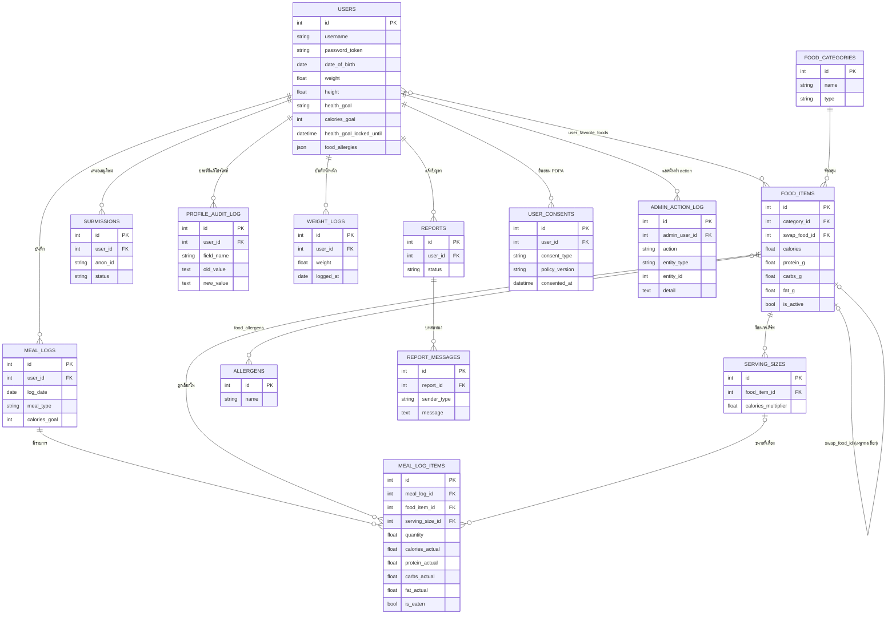

# DATABASE — Schema v2 (MariaDB)

สำรวจจาก `backend/models.py` จริงทั้งหมด (SQLAlchemy models = ต้นทาง
เดียวของ schema ในโปรเจกต์นี้ ไม่มีเครื่องมือ migration แบบ Alembic — การ
เปลี่ยน schema ทำผ่านสคริปต์ `ALTER TABLE` ตรงๆ เก็บไว้ที่ `backend/migrations/*.sql`)
มี 16 ตารางทั้งหมด — คำถามในโจทย์ระบุ 10 ตารางหลัก เอกสารนี้ครบทุกตารางจริง
รวม `report_messages`, `profile_audit_log`, และ 4 ตารางใหม่จาก Prompt 1 ของ
รอบปิดงาน (`weight_logs`, `user_favorite_foods`, `user_consents`,
`admin_action_log`) เพื่อให้ตรงกับ schema จริง 100%

---

## ตารางทั้งหมด

### `users`
เก็บบัญชีผู้ใช้ + ข้อมูลสุขภาพส่วนตัว (น้ำหนัก/ส่วนสูง/เป้าหมาย) — เป็น
"ความจริงเดียว" ของ BMI/TDEE/calories_goal โดยไม่เก็บค่าคำนวณซ้ำ (ยกเว้น
`calories_goal` ที่ต้อง persist เพราะเป็นค่าที่ผู้ใช้ "ล็อก" ไว้ ไม่ใช่ค่า
สดที่ recompute ได้ตลอด — ดู Q&A ข้อ 2)

| column สำคัญ | เหตุผลออกแบบ |
|---|---|
| `password_token` | token แบบสุ่ม (ไม่ใช่ JWT) ที่ใช้แทน session ทั้งระบบ — เปลี่ยนใหม่ทุกครั้ง login เพื่อ invalidate token เก่าอัตโนมัติ |
| `health_goal_locked_until` | ล็อกเปลี่ยนเป้าหมายซ้ำได้แค่ทุก 7 วัน (`NULL` = ยังไม่เคยตั้ง เปลี่ยนได้อิสระ) |
| `chronic_diseases`, `food_allergies` | เก็บเป็น `JSON` array ตรงๆ (ไม่แยกตารางลูก) เพราะเป็น multi-select ของผู้ใช้เอง ไม่ใช่ master data ที่ต้องอ้างอิงข้าม entity แบบ allergen ของเมนู |
| `is_deleted`, `delete_reason`, `deleted_at` | soft delete — แอดมินลบบัญชีได้แบบกู้คืนได้ (`/admin/user/<id>/restore`) ไม่ hard-delete ทันที |

**FK ออก:** ไม่มี (เป็นตาราง "แม่" ของทุกอย่างที่ผูกกับผู้ใช้)
**FK เข้า:** `meal_logs.user_id`, `reports.user_id`, `submissions.user_id`
(nullable — รองรับ submission แบบ anonymous), `profile_audit_log.user_id`,
`weight_logs.user_id`, `user_favorite_foods.user_id`, `user_consents.user_id`,
`admin_action_log.admin_user_id` (ไม่มี CASCADE — ดูเหตุผลที่ตารางนั้น)

---

### `food_categories`
หมวดหมู่เมนู เช่น "อาหารลดน้ำหนัก", "เครื่องดื่มคลายร้อน" — คอลัมน์
`type` (`food`/`drink`/`dessert`) คือสิ่งที่แยกว่าหมวดนี้อยู่กลุ่มไหนของ 3
กลุ่มเดิม (ดู Q&A ข้อ 1 ว่าทำไมไม่แยกตารางเมนูตาม type แทน)

**FK เข้า:** `food_items.category_id`

---

### `food_items`
เมนูอาหาร/เครื่องดื่ม/ของหวาน **1 ตารางรวม** (แทน `food_menus` /
`drink_menus` / `dessert_menus` เดิม 3 ตาราง — ดู Q&A ข้อ 1) เก็บค่าโภชนาการ
ต่อ "1 หน่วยมาตรฐาน" (multiplier = 1.0)

| column สำคัญ | เหตุผลออกแบบ |
|---|---|
| `calories`, `protein_g`, `carbs_g`, `fat_g` | ต้องสอดคล้องกับสูตร 4/4/9 เสมอ — ตรวจ+ซิงก์ด้วย `backend/tools/sync_food_items_calories.py` (ดู Q&A ข้อ 2) |
| `swap_food_id` | FK ชี้ตัวเอง (self-referencing, nullable) — เมนูทางเลือกที่ดีกว่าสำหรับคนที่ต้องการ "สลับเมนู" |
| `is_active` | soft-hide เมนูที่เลิกใช้ โดยไม่ลบแถว (กัน `meal_log_items` เก่าที่ยังอ้างถึง FK นี้พังตาม) |

**FK ออก:** `category_id → food_categories.id`, `swap_food_id → food_items.id` (self, nullable)
**FK เข้า:** `serving_sizes.food_item_id` (CASCADE), `food_allergens.food_item_id` (CASCADE), `meal_log_items.food_item_id`, `user_favorite_foods.food_item_id` (CASCADE)

---

### `serving_sizes`
ขนาดเสิร์ฟของเมนูหนึ่งๆ (เล็ก/กลาง/ใหญ่) เก็บแค่ **ตัวคูณเดียว**
(`calories_multiplier`) ที่ใช้คูณทั้งแคลอรีและ macro ทุกตัวพร้อมกันเสมอ
(ไม่ใช่คนละตัวคูณต่อ macro) — นี่คือกลไกที่ทำให้ "เปลี่ยนขนาด → แคลอรี
เปลี่ยนตามจริง" ทำงานถูกต้องแบบ atomic ไม่มีทางที่แคลอรีกับ macro จะขัดกัน

**FK ออก:** `food_item_id → food_items.id` (`ON DELETE CASCADE`)
**FK เข้า:** `meal_log_items.serving_size_id` (`ON DELETE SET NULL` — ลบขนาดเสิร์ฟทิ้งได้โดยไม่ลบประวัติการกินเก่า)

---

### `allergens`
master list ของสารก่อภูมิแพ้ (กุ้ง/ไข่/นม/ถั่ว ฯลฯ) — `name` unique
ตารางเดียว ไม่ผูกกับเมนูโดยตรง (ผูกผ่าน junction table ด้านล่าง)

**FK เข้า:** `food_allergens.allergen_id` (CASCADE)

---

### `food_allergens` (junction table)
เชื่อม `food_items` ↔ `allergens` แบบ many-to-many — เมนูหนึ่งมีได้หลาย
allergen, allergen หนึ่งอยู่ในหลายเมนูได้ นี่คือกลไกป้องกันข้อมูลแพ้อาหาร
ตกหล่นตัวจริง (ดู Q&A ข้อ 5) primary key คือคู่ `(food_item_id, allergen_id)`
เอง ไม่มี id แยก

**FK ออก:** `food_item_id → food_items.id` (CASCADE), `allergen_id → allergens.id` (CASCADE)

---

### `meal_logs`
มื้ออาหาร 1 มื้อ (เช้า/กลางวัน/เย็น) ของผู้ใช้ 1 คนใน 1 วัน — บังคับ
**บันทึกได้ครั้งเดียวต่อมื้อต่อวัน** ด้วย `UNIQUE KEY (user_id, log_date, meal_type)`
ระดับ DB ตรงๆ (ไม่ใช่แค่เช็คใน application layer) กัน race condition ที่
กด "บันทึก" พร้อมกัน 2 ครั้งจากอุปกรณ์คนละเครื่อง

| column สำคัญ | เหตุผลออกแบบ |
|---|---|
| `calories_goal` | **snapshot** ของ `users.calories_goal` ณ วันที่บันทึก ไม่ join สดจาก `users` — กันกรณีผู้ใช้เปลี่ยนเป้าหมายทีหลัง แล้วประวัติเก่าเปลี่ยนความหมายย้อนหลังไปด้วย |

**FK ออก:** `user_id → users.id` (CASCADE)
**FK เข้า:** `meal_log_items.meal_log_id` (CASCADE)

---

### `meal_log_items`
รายการเมนูที่เลือกไว้ในมื้อนั้น — เลือกได้หลายเมนูต่อมื้อ (FoodBrowserPage
เลือกสะสมไว้ก่อน โชว์ kcal รวม แล้วค่อยกด "ยืนยัน" ยิง `POST
/meal-logs/<id>/items` ทีละรายการ) ไม่มี constraint ระดับ DB ที่จำกัดจำนวน
รายการต่อมื้อ

| column สำคัญ | เหตุผลออกแบบ |
|---|---|
| `calories_actual`, `protein_actual`, `carbs_actual`, `fat_actual` | **snapshot** คำนวณตอนบันทึก (`food_items.<macro>_g × serving.calories_multiplier × quantity` แล้วผ่านสูตร 4/4/9) กันค่าฐานที่ `food_items` เปลี่ยนย้อนหลังทำให้ประวัติเก่าคำนวณผิดใหม่ |
| `is_eaten`, `eaten_at` | แยก "วางแผนจะกิน" (แถวถูกสร้าง) ออกจาก "กินแล้วจริง" (กดปุ่ม "ทานแล้ว") — dashboard ใช้ 2 สถานะนี้แยก `planned_calories` กับ `eaten_calories` |

**FK ออก:** `meal_log_id → meal_logs.id` (CASCADE), `food_item_id → food_items.id`, `serving_size_id → serving_sizes.id` (`ON DELETE SET NULL`)

---

### `reports`
ticket 1 เรื่องที่ผู้ใช้แจ้งปัญหา — `status` (`pending`/`replied`/`closed`)
ควบคุมว่าฝั่งผู้ใช้ตอบต่อได้ไหม (`closed` = read-only ทั้งสองฝั่ง) ฟิลด์
`message`/`admin_reply` เดิมยังอยู่เพื่อ backward-compat แต่บทสนทนาจริง
ทั้งหมดย้ายไปอยู่ `report_messages` แล้ว (รองรับตอบโต้กันได้หลายรอบ ไม่ใช่
แค่ 1 ข้อความ+1 คำตอบเหมือนเดิม)

**FK ออก:** `user_id → users.id` (CASCADE)
**FK เข้า:** `report_messages.report_id` (CASCADE)

---

### `report_messages`
ข้อความ 1 รายการในบทสนทนาของ ticket หนึ่ง (`sender_type`: `user`/`admin`)
เรียงตาม `created_at` — เพิ่มเข้ามาแทนรูปแบบเดิมที่ `reports` เก็บได้แค่
ข้อความแรก+คำตอบแรกอย่างละ 1 ข้อความ

**FK ออก:** `report_id → reports.id` (CASCADE)

---

### `submissions`
ข้อเสนอเมนูใหม่จากผู้ใช้ให้แอดมินตรวจอนุมัติ (`POST /submit`) — แยกจาก
`food_items` เพราะยังไม่ผ่านการตรวจ ป้องกันเมนูที่ข้อมูลผิด/สแปมเข้าไปปน
กับเมนูจริงที่ผู้ใช้อื่นเห็น รองรับทั้งผู้ใช้ที่ login แล้ว (`user_id`) และ
guest (`anon_id`, unique — กันส่งซ้ำจากอุปกรณ์เดียวกัน)

**FK ออก:** `user_id → users.id` (CASCADE, nullable), `reviewed_by → users.id`
(nullable — NULL ได้ถ้าแอดมิน auth ผ่าน shared secret ล้วนๆ ไม่ได้ login
แบบผูกกับ user คนไหนเจาะจง)

---

### `profile_audit_log`
1 แถวต่อ 1 field ที่ผู้ใช้แก้ในโปรไฟล์ตัวเอง (เขียนอัตโนมัติทุกครั้งที่
`POST /user/<id>` เปลี่ยนค่าจริง) เป็นแหล่งข้อมูลเดียวของหน้า "ประวัติการ
แก้ไขโปรไฟล์" ฝั่งแอดมิน ซึ่ง**อ่านอย่างเดียว** — ไม่มี endpoint ไหนแก้/ลบ
แถวในตารางนี้เลย (ดู Q&A ข้อ 3)

**FK ออก:** `user_id → users.id` **ไม่มี** `ON DELETE CASCADE` (เหมือน
`admin_action_log.admin_user_id` ด้านล่าง — เอกสารรุ่นก่อนอ้างว่า
`admin_action_log` เป็นตารางเดียวที่ไม่มี cascade ซึ่งไม่ครบ ตารางนี้ก็ไม่มี
เหมือนกัน ตั้งใจให้ audit trail อยู่รอดแม้บัญชีผู้ใช้ที่ถูกลบไปแล้ว)

---

### `weight_logs`
น้ำหนักที่ผู้ใช้บันทึกเอง 1 แถวต่อ 1 วัน (หน้า "น้ำหนักย้อนหลัง" บน
ProfilePage) — บันทึกซ้ำวันเดียวกันเป็นการ **update ค่าเดิม** ไม่ใช่สร้างแถว
ใหม่ (ต่างจาก `meal_logs` ที่ห้ามซ้ำมื้อ/วันเดียวกันแบบ error 409) เพราะ
"แก้น้ำหนักของวันนี้ที่เพิ่งกรอกผิด" เป็น use case ที่สมเหตุสมผลกว่า

| column สำคัญ | เหตุผลออกแบบ |
|---|---|
| `logged_at` | วันที่ของค่าน้ำหนักนี้ (ไม่ใช่แค่ `created_at` ที่บันทึก) — รองรับ backfill ย้อนหลังได้ผ่าน `logged_at` ที่ส่งมาเอง |
| `UNIQUE(user_id, logged_at)` | บังคับ "1 วัน 1 ค่า" ระดับ DB ตรงๆ — ทำให้ endpoint ใช้ upsert (`SELECT` หาแถวเดิมก่อน `UPDATE`/`INSERT`) แทนตรวจซ้ำใน application layer เฉยๆ |

`users.weight` ถูก sync ให้ตรงกับค่าของ `logged_at` **ล่าสุด** เสมอหลัง POST
ทุกครั้ง (ไม่ใช่ค่าที่เพิ่ง POST ล่าสุด) กันกรณี backfill วันที่เก่ากว่าทำให้
`users.weight` เพี้ยนไปจากค่าจริงของวันนี้ที่เคยบันทึกไว้แล้ว

**FK ออก:** `user_id → users.id` (CASCADE)

---

### `user_favorite_foods`
รายการโปรดของผู้ใช้ (ปุ่มดาวบน `AppFoodCard`) — junction table แบบ
many-to-many ระหว่างผู้ใช้กับเมนู ไม่มี `id` แยก ใช้คู่
`(user_id, food_item_id)` เป็น primary key ตรงๆ เหมือน `food_allergens` ทำ
ให้ "กดดาวซ้ำ"/"เอาออกซ้ำ" เป็น idempotent โดยธรรมชาติ (INSERT ซ้ำ primary
key เดิม หรือ DELETE แถวที่ไม่มีอยู่แล้ว ไม่ error ทั้งคู่)

**FK ออก:** `user_id → users.id` (CASCADE), `food_item_id → food_items.id` (CASCADE)

---

### `user_consents`
หลักฐานการยินยอม PDPA — **append-only** (1 แถวต่อ 1 ครั้งที่กดยินยอมจริง
ไม่ update ทับของเดิม) เพราะต้องพิสูจน์ย้อนหลังได้ว่าผู้ใช้ยินยอมนโยบาย
เวอร์ชันไหนตอนไหน ไม่ใช่แค่เก็บสถานะล่าสุด — แยกออกจาก `users` โดยตั้งใจ
(ดู PRESENTATION_QA.md) เพราะเป็นคนละเรื่องกับ profile: `users` คือข้อมูล
ปัจจุบัน ส่วนนี่คือ audit trail ของการยินยอม

| column สำคัญ | เหตุผลออกแบบ |
|---|---|
| `policy_version` | เทียบกับ `CURRENT_PDPA_POLICY_VERSION` (ค่าคงที่ใน `backend/config.py`) ตอน `GET /api/consents/status` — ถ้านโยบายถูก bump เวอร์ชันใหม่ทีหลัง แถวที่ยินยอมเวอร์ชันเก่าจะไม่นับว่า `consented=true` อีกต่อไป ต้องยินยอมใหม่ |
| `consent_type` | เผื่ออนาคตมีความยินยอมหลายประเภทแยกกัน (ตอนนี้มีแค่ `health_data_pdpa`) |

**FK ออก:** `user_id → users.id` (CASCADE)

---

### `admin_action_log`
1 แถวต่อ 1 ครั้งที่แอดมินแก้/ลบข้อมูลสำคัญสำเร็จ (สร้าง/แก้/ลบเมนู,
หมวดหมู่, อนุมัติ/ปฏิเสธข้อเสนอเมนู, ตอบ/ปิด ticket, ลบ/กู้คืนผู้ใช้) — เพื่อ
ให้ตรวจสอบได้ว่าใครทำอะไรเมื่อไหร่ในทีมที่มีแอดมินหลายคน เขียนเฉพาะ action
ที่เปลี่ยนข้อมูลจริง ไม่ hook endpoint ที่แค่อ่านอย่างเดียว

| column สำคัญ | เหตุผลออกแบบ |
|---|---|
| `admin_user_id` | FK ไป `users.id` **ไม่มี** `ON DELETE CASCADE` (เหมือน `profile_audit_log.user_id` — ดูหัวข้อนั้น — 2 ตารางนี้เท่านั้นในไฟล์ที่ไม่มี cascade) — ตั้งใจให้ audit trail อยู่รอดแม้บัญชีแอดมินที่ทำ action นั้นถูกลบไปแล้ว |
| `entity_type`, `entity_id` | ระบุว่า action นี้กระทำกับ record ไหนของตารางไหน (เช่น `food_item`/`123`) — ไม่ทำเป็น FK จริงเพราะ `entity_type` ชี้ไปได้หลายตาราง (polymorphic) |
| `detail` | ข้อความอิสระอธิบายเพิ่มเติม (เช่น ชื่อเมนูที่ลบ, เหตุผลที่ปฏิเสธข้อเสนอ) — เผื่อ `entity_id` อย่างเดียวไม่พอสื่อความหมายหลัง record ต้นทางถูกลบไปแล้วจริง |

การเขียนแถวนี้ (`_log_admin_action` ใน `backend/admin/admin_routes.py`) จะ
**ข้ามเงียบๆ** ถ้าแอดมิน auth ผ่าน `X-Admin-Secret` ล้วนๆ โดยไม่ได้ login
แบบผูก session (`admin_user_id` เป็น `NOT NULL` ตาม schema — ไม่มี "ใคร"
จริงที่ผูก session ไว้ก็ log ไม่ได้อยู่แล้ว) ต้อง login ผ่าน `POST
/admin/login` ด้วยบัญชีที่ `is_admin=true` จริงถึงจะเห็นแถวใหม่ในหน้า
"ประวัติการทำงานของแอดมิน"

**FK ออก:** `admin_user_id → users.id` (ไม่มี `ON DELETE CASCADE`)

---

## ER Diagram

---

## อ้างอิงเพิ่มเติม

- ที่มาของสูตรที่คำนวณจาก column พวกนี้: `backend/WORKED_EXAMPLE.md`
- คำถามที่อาจารย์อาจถามเกี่ยวกับการออกแบบ schema: `PRESENTATION_QA.md`
- โครงสร้างโค้ดที่อ่าน/เขียนตารางเหล่านี้: `ARCHITECTURE.md`
- รูปแบบ JSON ของ `/api/dashboard` โดยละเอียด: `docs/api_contract.md`
